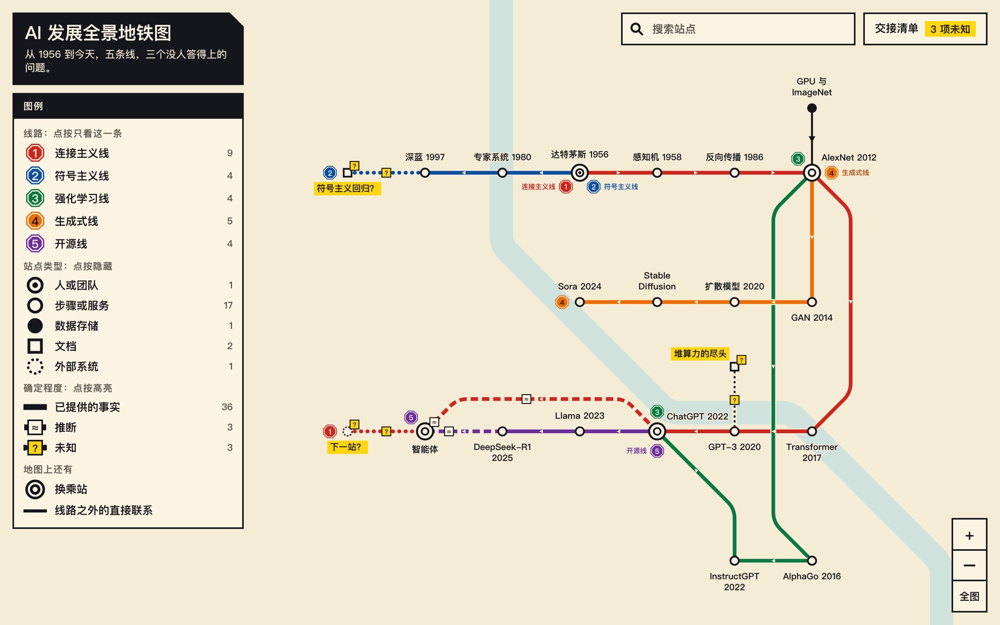

# Transit Atlas

[中文说明](README.zh.md) · [Open the live map](https://superevh.github.io/transit-atlas/)

An Agent Skill that turns a complicated field or system into a transit map you can search, zoom and question. Anything nobody can answer stays on the map as a yellow question mark.



## Why

A hard field is hard because you cannot see how its parts connect. Lists and mind maps do not show that. Most diagrams also look finished, even where nobody knows the answer, and an AI asked to draw one will fill the gaps with confident guesses.

Transit Atlas keeps three things apart:

| On the map | Meaning |
|---|---|
| Solid track | You said it |
| `≈` plate | The agent inferred it, and says why |
| Yellow `?` | Nobody knows yet, and it is written as a question to go and ask |

## What you get

One HTML file. It works offline, makes no network requests and runs in any current browser.

- Search, zoom and pan
- Click a station to focus it and see every relationship
- Filter by line, station type or certainty
- A handoff sheet listing facts, inferences and unknowns

Up to 60 stations, 8 lines and 120 relationships. The layout is computed, so every map comes out in the same style.

## Install

```bash
git clone https://github.com/Superevh/transit-atlas ~/.claude/skills/transit-atlas
```

That path is for Claude Code. For any other agent that reads `SKILL.md`, clone it into that agent's skills folder.

## Use

Tell your agent:

> Use transit-atlas to draw this as a transit map: [paste your notes, docs or a description of the system]

The agent writes one data file, then the scripts build and check the map:

```bash
node scripts/build.mjs system.json map.html   # build
node scripts/check.mjs map.html               # legibility and rule checks
node scripts/handoff.mjs map.html             # facts, inferences, unknowns
```

These need Node 18 or newer and nothing else. `scripts/drive.mjs` also clicks through the finished map in a real browser, and that one needs Playwright.

## Examples

Each folder holds the brief, the data and the map.

| Example | Live map |
|---|---|
| [70 years of AI](examples/ai-history) (Chinese) | [Open](https://superevh.github.io/transit-atlas/) |
| [Data science, end to end](examples/data-science) (Chinese) | [Open](https://superevh.github.io/transit-atlas/data-science.html) |
| [Library loans](examples/library), fictional (English) | [Open](https://superevh.github.io/transit-atlas/library.html) |

## When not to use it

- For exact timing between services, use a sequence diagram
- For a precise database schema, use an ER diagram
- If it only needs to work on paper, the value here is the interaction
- If the system is one straight line of steps, a list is enough

## License

MIT. By [AIYun](https://aiyun.com.au).
