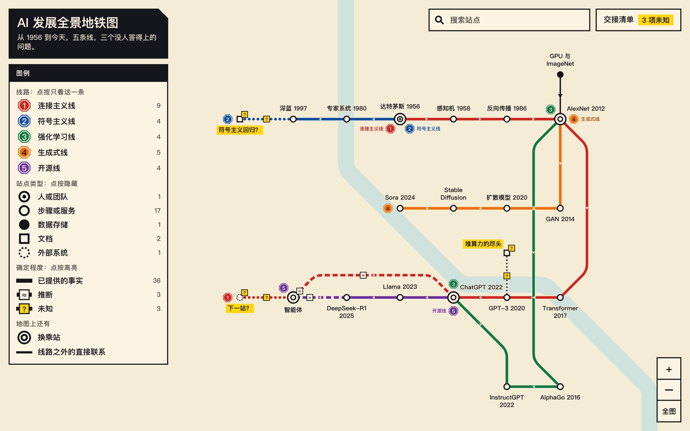

# 地铁图架构图 Transit Atlas

[English](README.md) · [打开在线地图](https://superevh.github.io/transit-atlas/)

一个 Agent Skill：把一个复杂的领域或系统，画成一张能搜索、能缩放、能追问的地铁图。没人答得上来的地方，一直用黄色问号标在图上。



## 为什么做它

一个领域难懂，往往是因为看不出各部分怎么连起来。清单和思维导图都表现不了这个。大多数图还看起来很完整，哪怕有些地方其实没人知道答案；让 AI 来画，它还会把空白填上一个很自信的猜测。

这张图把三种东西分开：

| 图上的样子 | 意思 |
|---|---|
| 实线轨道 | 你说过的 |
| `≈` 标牌 | AI 推断的，并写明理由 |
| 黄色 `?` | 还没人知道，写成一个要去问的问题 |

## 你会得到什么

一个 HTML 文件。离线可用，不发任何网络请求，用现在的浏览器都能打开。

- 搜索、缩放、拖动
- 点一个站，聚焦它，并列出它的所有关系
- 按线路、站点类型、确定程度筛选
- 一份交接清单，分开列出事实、推断和未知

上限是六十站、八条线、一百二十条关系。布局全部由程序算出，所以每张图都是同一种样子。

## 安装

```bash
git clone https://github.com/Superevh/transit-atlas ~/.claude/skills/transit-atlas
```

这是 Claude Code 的路径。其他能读 `SKILL.md` 的 Agent，克隆到它自己的技能文件夹。

## 怎么用

对你的 Agent 说：

> 用 transit-atlas 把下面这段画成地铁图：（贴你的笔记、文档，或者一段描述）

Agent 只写一个数据文件，然后脚本负责生成和检查：

```bash
node scripts/build.mjs system.json map.html   # 生成
node scripts/check.mjs map.html               # 检查清晰度和规则
node scripts/handoff.mjs map.html             # 列出事实、推断、未知
```

只需要 Node 18 或更新的版本。`scripts/drive.mjs` 会在真实浏览器里把成品点一遍，这一个需要 Playwright。

## 示例

每个文件夹里都有原始描述、数据和成品。

| 示例 | 在线地图 |
|---|---|
| [AI 七十年](examples/ai-history) | [打开](https://superevh.github.io/transit-atlas/) |
| [数据科学全景](examples/data-science) | [打开](https://superevh.github.io/transit-atlas/data-science.html) |
| [图书馆借书](examples/library)，虚构（英文） | [打开](https://superevh.github.io/transit-atlas/library.html) |

## 什么时候别用它

- 要表现服务之间准确的时序：用时序图
- 要表现精确的数据库结构：用 ER 图
- 只看纸质版：这张图的价值在交互
- 系统只是一串直线步骤：一份清单就够了

## 许可证

MIT。作者 [AIYun](https://aiyun.com.au)。
